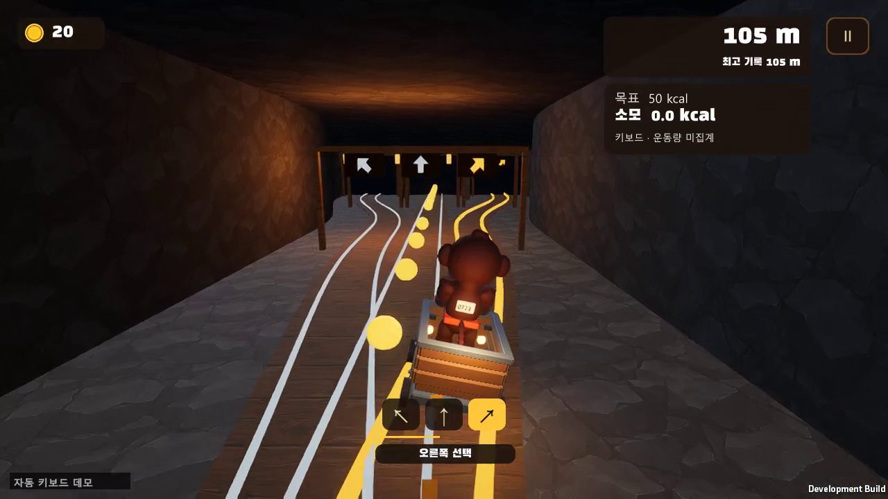
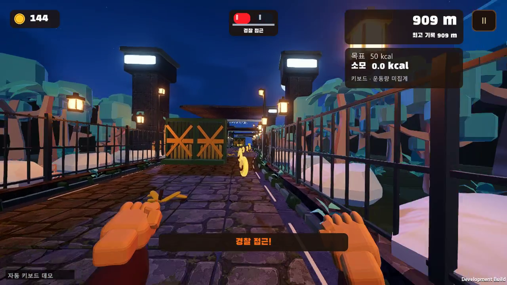

# 전체 플레이 녹화·출시 검수 (2026-10-26)

[전체 영상](https://github.com/kihwan04/PrisonRunner/releases/download/v2026.10.26-r2/Mongscape-Gameplay-Full.mp4) · [실행 파일과 자료](https://github.com/kihwan04/PrisonRunner/releases/tag/v2026.10.26-r2)

## 실제 녹화

- 길이 126.33초, 3,790프레임, 1280×720/30fps, H.264 MP4 + AAC 게임 소리.
- 타이틀 → 메인 메뉴 → 준비 → 광산 → 수레·갈림길 → 감옥 → 동물원 → 경찰 추격·잡힘 → 결과 화면을 연속 녹화했습니다.
- 자동 키보드 입력을 영상 왼쪽 아래에 표시합니다. 공통 MotionCommand로 조작하며 순간이동·무적·시간 건너뛰기·구간 이어붙이기를 사용하지 않습니다. 마지막에 바나나 두 번을 실제 접촉해 정상 추격/결과로 마칩니다.
- 내부 마지막 거리 1011.33m. 결과 UI의 점수는 게임이 정산한 값입니다. 코끼리·기린·나무 조우 플래그 7, 바나나 접촉 2를 기록했습니다.
- 키보드 플레이이므로 소모 칼로리는 0.0/미집계입니다. 실제 운동 추정값을 녹화한 자료가 아닙니다.
- 별도 PLAY DEMO 데이터 폴더와 시험 실행 프로필을 사용했습니다. 기존 저장 기록·랭킹을 변경하지 않습니다. 화면은 최종 게임 프레임버퍼만, 소리는 게임 AudioListener만 캡처합니다. 웹캠·마이크·다른 앱은 포함하지 않습니다.
- 광산·갈림길은 3인칭, 감옥·동물원은 기존 1인칭 연출을 유지합니다. 단일 플레이이므로 모든 무작위 경로·메뉴·웹캠을 시연한 것은 아닙니다.

| 시각 | 장면 |
| --- | --- |
| 00:00 | 타이틀 |
| 00:02 | 메인 메뉴 |
| 00:04 | 키보드 플레이 준비 |
| 00:08 | 플레이 시작 |
| 00:08 | 광산 |
| 00:10 | 수레 철로 |
| 00:33 | 감옥 진입 · 하이니 |
| 00:36 | 감옥 구간 |
| 01:38 | 코끼리 코 장애물 |
| 01:39 | 동물원 구간 |
| 01:41 | 쓰러지는 나무 |
| 01:43 | 기린 목 장애물 |
| 01:48 | 바나나 접촉 · 사이렌 경고 |
| 01:57 | 두 번째 바나나 · 경찰 추격 |
| 01:58 | 경찰에게 잡힘 |
| 02:02 | 결과 화면 |

## 검사

최종 MP4 전체를 디코딩해 오류 0을 확인했습니다. 영상 H.264/1280×720/30fps와 AAC 스트림, 소스 게임 오디오 48kHz 스테레오/126.38초를 확인했습니다. 소리 RMS -31.07dBFS, 최대 0.622로 무음·클리핑 여부를 수치로 검사했습니다. 주요 프레임의 방향·HUD·갈림길·동물·사이렌·결과를 시각 검수했습니다.

Windows 빌드와 녹화 실행은 종료 코드 0입니다. 최신 공개 소스 Unity 전체 검사 결과는 아래에 기록합니다.

공개 소스 전체 검사: EditMode **129/129**, PlayMode **41/41**, 실패 0·종료 코드 0. Mixamo 원본 8개 파일을 제외하고 자체 Blender 컨트롤러로 연결한 소스에서 새로 수행했습니다. [검사 요약](../previews/GameplayRecording20261026/validation.json)과 같은 폴더의 EditMode.xml/PlayMode.xml에 근거를 보관합니다. 컴파일 오류는 없고 기존 맵 코드 경고와 Unity 종료 정리 진단은 남아 있습니다.

공개 소스·ZIP은 비밀 설정·개인 DB·얼굴·캐시와 Mixamo 원본을 제외합니다. 공개 소스의 두 애니메이션 컨트롤러는 자체 Blender 동작으로 연결하므로 배포 EXE와 애니메이션 리소스가 다릅니다. 원래 작업 폴더의 Git merge/index는 변경하지 않고 별도 게시 체크아웃에서 커밋합니다.

원시 녹화 메타데이터: [recording.json](../previews/GameplayRecording20261026/recording.json).

## 남은 범위

실물 웹캠·iOS/Android 연결·몸동작 장시간 플레이, 다양한 PC 성능, Docker 컨테이너 기동·외부 HTTPS·두 PC 데이터 공유는 별도 확인이 필요합니다. 이번 30fps 녹화는 성능 벤치마크가 아닙니다. 이전 자동 전체 메뉴 캡처 종료 오류와 Unity 종료 진단은 [진행 상태](../PROGRESS.md)에 보존합니다.

게시 준비 갱신: 2026-10-29. develop의 기존 Tailscale 설정과 이전 문서 삭제를 보존해 통합했습니다. 원격 변경은 Unity 코드에 없으며 위 검사를 수행한 게임 소스의 모든 파일 해시를 다시 비교했습니다. Tailscale 설정의 실제 기동은 이번 작업에서 검증하지 않았습니다. 열린 기능 통합 PR #20은 이번 게시에 병합하지 않았습니다.
